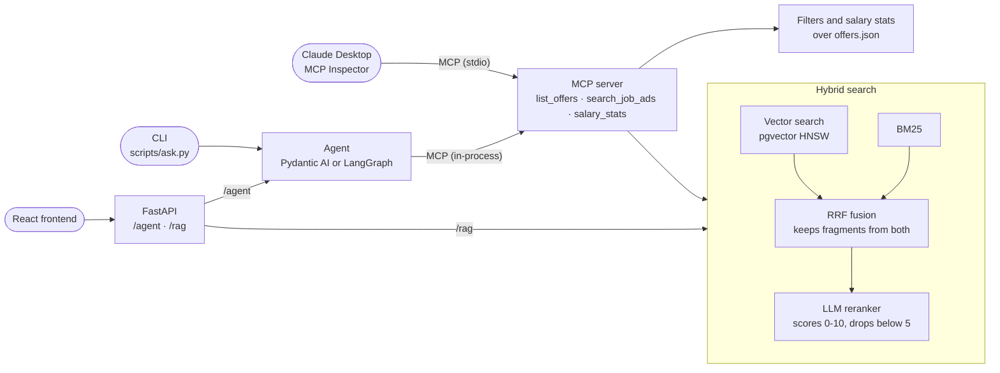

# Job Offers AI

[](https://github.com/BaseAdam/job-offers-ai/actions/workflows/ci.yml)

An LLM application that answers questions about a set of job offers, built to learn and
show AI engineering end to end: hybrid retrieval with reranking, evaluation of retrieval,
answers and agents, request-level observability, and three versions of the same agent
(hand-written, Pydantic AI, LangGraph) that share one MCP tool server.

Python 3.14 · Gemini · Postgres + pgvector · FastAPI · Pydantic AI · LangGraph · MCP

## What's inside

- **Hybrid search**: vector search (pgvector, HNSW) and BM25 combined with reciprocal rank
  fusion, then an LLM reranker that scores each fragment 0–10 and drops weak matches.
- **RAG answers** with numbered citations, checked in code against the sources.
- **Agents** that pick tools themselves: list and filter offers, search the ad texts, compute
  salary statistics. They return a structured answer: text plus the exact offer titles.
- **MCP server** exposing the same three tools to any MCP client (Claude Desktop, MCP Inspector)
  and, in-process, to the Pydantic AI and LangGraph agents.
- **Evals**: retrieval metrics with regression thresholds, citation checks, an LLM judge
  calibrated against human labels, and agent tasks that check both the answer and the path.
- **React frontend**: ask a question and see the answer, the matching offers and the agent's
  path drawn as numbered steps with its token usage. Vite, TypeScript, Vitest.
- **FastAPI app**: `/agent` (the Pydantic AI agent: answer, offers, the tools used in each step
  and token usage), `/rag` (cited answers), `/ask` (tool-calling assistant), `/offers` (filters),
  `/offers/extract` (structured data from a pasted job ad), `/offers/{index}/tips` (streamed
  interview tips). Database connections come from a pool, so a busy or missing database
  gives a 503 within 5 s instead of a hanging request.
- **Docker**: one multi-stage image that builds the React app with npm and the API with uv
  (dependencies in their own cached layers, no dev tools, non-root user); FastAPI serves the
  built frontend. A compose file runs it together with Postgres and Jaeger.
- **Observability**: per-request IDs, step timings and token counts in the logs (text or JSON),
  and OpenTelemetry traces in Jaeger: one trace per request, from the HTTP call through the
  agent run, every model call and every MCP tool call down to the search steps inside a tool.

## Architecture



Each job ad is split into its sections (about the company, responsibilities, requirements,
what we offer), and every chunk starts with a header line with the title, company, city and
skills. Chunks are embedded with `gemini-embedding-001` (768 dimensions). BM25 is a small
in-house implementation with crude stemming. The data is 18 synthetic offers in five Polish
cities; the ad texts were generated with Gemini by
[`scripts/generate_descriptions.py`](scripts/generate_descriptions.py).

## Results

All numbers come from the eval scripts in [`evals/`](evals). The datasets are small, so treat
them as signals, not benchmarks.

### Retrieval

Dev set: 19 questions with known relevant offers, plus 3 that should return nothing.

| | vectors | BM25 | hybrid | hybrid + reranker |
|---|---|---|---|---|
| recall@5 | 0.85 | 0.97 | 0.95 | **0.98** |
| precision@5 | 0.36 | 0.40 | 0.39 | **0.83** |
| MRR | 0.78 | 0.96 | 0.93 | **1.00** |
| off-topic questions refused | 0.67 | 0.33 | 0.67 | **1.00** |

The reranker barely changes recall; its value is precision and refusing off-topic questions.
Minimum values live in [`evals/retrieval-thresholds.json`](evals/retrieval-thresholds.json):
BM25 is checked in every `pytest` run, the full pipeline on demand.

### Answers

- **Citations**: precision 0.94, recall 0.99, no invented citation numbers.
- **LLM judge**: three separate verdicts per answer (grounded, citations correct, answers the
  question), with its reasoning written before the verdicts. It agrees with human labels on
  42 of 42 decisions: 14 answers × 3 criteria, 9 of them broken on purpose (swapped citations,
  an invented fact, an off-topic answer).
- **Latency**: the LLM calls take about 85% of a RAG request; refusals skip generation and
  return in under 0.4 s. A RAG answer costs roughly 1.2–2k tokens.

### Agents

Ten multi-step tasks, e.g. "What is the average salary of the jobs whose ads explicitly offer
flexible working hours?" (search the ads, then compute stats for exactly the matching offers).
Each run is checked twice: the answer (titles, numbers, refusals) and the path (required and
forbidden tools, a step budget of the shortest sensible path plus one spare step).

| | hand-written | Pydantic AI | LangGraph |
|---|---|---|---|
| answers correct | 9/10 \* | 30/30 | 30/30 |
| pass^3 (task passed in all 3 runs) | – | 10/10 | 10/10 |
| paths within the rules | 9/10 | 30/30 | 30/30 |
| agent steps per run | 2.6 | 2.3 | 2.3 |
| LLM calls per run | 3.2 | 2.7 | 2.7 |
| tokens per run | ~3,770 | 3,384 | 3,466 |
| lines of agent code | 202 | 83 | 134 |

\* A single run from an earlier stage, before the fusion fix described below. Without a
structured list of offers the check has to search the answer text, and one answer named an
offer only to exclude it.

Baselines on the same tasks: an earlier tool-calling assistant scored 8/10 and single-pass RAG
5/10. With the same model and the same tools, the framework did not change answer quality. It
changed how much code I own and how much of the loop I can see.

## Frontend

A single-page React app in [`frontend/`](frontend) (Vite, TypeScript) for asking the Pydantic AI
agent questions. It shows:

- a question box with example questions, and a timer while the agent works (a run takes a few
  seconds);
- the answer and the matching offers with their companies, cities, salary ranges and skills;
- the agent's path: one numbered stop per agent step with the tools it called (`list_offers`,
  `search_job_ads`, `salary_stats`), and the model calls and tokens the whole request used;
- a plain message when something fails: the database is down, the model timed out, or the agent
  ran out of steps.

It talks only to `POST /agent`. In development Vite forwards that path to the API on port 8000;
in the Docker image the API serves the built files itself (`app.frontend()`), so the app has one
origin and needs no CORS. The tests use Vitest and Testing Library, and CI lints, tests and
builds the app.

## Tracing

Every request becomes one OpenTelemetry trace, viewable in Jaeger:

- FastAPI creates the request spans and exports them when an OTLP endpoint is set;
- Pydantic AI adds the agent run, each model call (with its token counts) and each tool call;
- the MCP SDK carries the trace context from the agent into the tool server, so spans from
  inside a tool land under that tool call;
- the app's own steps (`rag.embed`, `rag.search`, `rag.rerank`, `rag.generate`) are spans too,
  with the tokens of their model calls as `llm.usage` events.

One agent question that searches the ads, simplified:

```
POST /agent
  pyai.run                              tokens of the whole run
    invoke_agent offers_agent
      chat gemini-3.5-flash-lite        the model picks a tool
      execute_tool search_job_ads
        tools/call search_job_ads       MCP client -> MCP server
          rag.embed
          rag.search                    vectors + BM25 + fusion
          rag.rerank                    reranker tokens
      chat gemini-3.5-flash-lite        the model writes the answer
```

With `LOG_JSON=true` every log line carries its `trace_id`, so a log line leads straight to its
trace. How to run it is under [Tracing locally](#tracing-locally).

## Engineering notes

Things the evals and the debugging taught me, in the order they came up.

- **Fix the test, not the label.** The judge was calibrated with deliberately broken answers,
  one kind of break per answer. When one "broken" answer turned out not to be broken, I
  replaced the test case based on a checkable fact instead of relabeling it to match the judge.
- **Structured output makes evals precise.** Once the agent returned `offers: list[str]`, the
  checks stopped searching the answer text, and a recurring false alarm disappeared.
- **Count agent steps, not LLM calls.** The search tool calls the reranker internally, so a
  budget in LLM calls depended on a config flag. Steps measure the agent's decisions; LLM calls
  stay in the report as cost.
- **The bug the agent evals found.** An agent that searched for just "mentor" missed two of
  three offers. The diagnosis script showed BM25 had found the right ad sections, but fusion
  kept only the fragment from the higher-ranked list, so the reranker saw generic sections and
  scored them 0. Fusion now passes fragments from both lists: the same query scores 10 for all
  three offers, and the task went from 4/5 to 5/5 passing runs.
- **`temperature` did nothing.** For `gemini-3.5-flash-lite` the API ignores `temperature`,
  `top_p` and `top_k` ([Google docs](https://ai.google.dev/gemini-api/docs/generate-content/whats-new-gemini-3.6)),
  which explained why the same agent wrote different search queries between runs. That is why
  reliability is measured with repeated runs (pass^k). The code no longer sends these
  parameters, and a test keeps it that way.
- **Read what the framework actually sends.** `ChatGoogleGenerativeAI` ignores an injected
  client and builds its own, so retry and timeout settings are passed per request. The MCP SDK
  configures root logging when a server is created. `langchain-mcp-adapters` still imports
  modules removed in `mcp` 2.x, so the LangGraph agent has its own 12-line MCP adapter.

## Running it locally

Requirements: Python 3.14, [uv](https://docs.astral.sh/uv/), Node.js 22+, Docker and a
[Gemini API key](https://aistudio.google.com/apikey).

```bash
docker compose up -d db                   # Postgres with pgvector
cp .env.example .env                      # then set GEMINI_API_KEY
uv sync
uv run python scripts/index_offers.py     # chunk, embed and store the offers
```

Ask an agent:

```bash
uv run python scripts/ask.py "Is the average salary higher in Krakow or in Warsaw?"
uv run python scripts/ask.py --agent graph "Where in Poznan will a junior get support from a mentor?"
```

Run the API (docs at http://127.0.0.1:8000/docs):

```bash
uv run fastapi dev src/offers/api.py
curl -X POST http://127.0.0.1:8000/rag -H "Content-Type: application/json" \
     -d '{"question": "Which offers provide equipment for remote work?"}'
curl -X POST http://127.0.0.1:8000/agent -H "Content-Type: application/json" \
     -d '{"question": "Is the average salary higher in Krakow or in Warsaw?"}'
```

Run the frontend (with the API running on port 8000, Vite forwards the API calls to it):

```bash
cd frontend
npm install
npm run dev                               # http://localhost:5173
```

Or run the whole app in Docker (the indexing step is needed once, the data stays in a volume):

```bash
docker compose up --build -d
docker compose run --rm api python scripts/index_offers.py
```

The app is at http://127.0.0.1:8000 and the API docs at http://127.0.0.1:8000/docs. Compose
reads `.env` but points `DATABASE_URL` at the `db` service.

Use the tools from an MCP client:

```bash
npx @modelcontextprotocol/inspector uv run python -m offers.mcp_server
```

For Claude Desktop, add the server to its config file:

```json
{
  "mcpServers": {
    "job-offers": {
      "command": "uv",
      "args": ["--directory", "/path/to/job-offers-ai", "run", "python", "-m", "offers.mcp_server"]
    }
  }
}
```

### Tracing locally

Compose also starts Jaeger, and the API container sends its traces there. Ask a question, then
open http://127.0.0.1:16686 and pick the `job-offers-ai` service. With `LOG_JSON=true` every
log line carries its `trace_id`, so a log line leads to its trace.

FastAPI exports traces when an OTLP endpoint is set in the environment. To trace the API
running outside Docker (PowerShell; these variables go in the shell, not in `.env`):

```powershell
docker compose up -d db jaeger
$env:OTEL_SERVICE_NAME = "job-offers-ai"
$env:OTEL_EXPORTER_OTLP_TRACES_ENDPOINT = "http://localhost:4318/v1/traces"
uv run fastapi dev src/offers/api.py
```

Any backend that accepts OTLP over HTTP works the same way.

### Tests and evals

```bash
uv run pytest                    # tests that need Postgres are skipped when it is not running
uv run ruff check . && uv run mypy
cd frontend && npm run lint && npm test && npm run build

uv run python evals/run_retrieval.py --rerank           # exit code 1 = regression, 2 = interrupted
uv run python evals/run_agent.py pyai graph --repeat 3  # agent tasks with pass^k
uv run python evals/generate_answers.py                 # then check_citations.py, judge_answers.py
uv run python evals/calibrate_judge.py                  # judge vs human labels
```

GitHub Actions runs format, lint, types and the whole test suite (with Postgres, so the BM25
retrieval gate is included) on every push. It also builds the Docker image and checks that the
API in it answers, and lints, tests and builds the frontend. The retrieval eval with the
reranker calls Gemini, so it is a separate workflow started by hand; it needs a
`GEMINI_API_KEY` repository secret.

The evals call Gemini many times; on the free tier a full agent run takes several minutes. They
use a 90 s model timeout (the API keeps 30 s, because a user is waiting), and the agent eval
stops with a partial summary when the daily quota runs out.

## Project layout

```
src/offers/
  config.py, llm.py              settings and the Gemini client (timeouts, retries)
  chunking.py, embeddings.py,
  store.py                       indexing and pgvector storage
  keywords.py, retrieval.py,
  rerank.py, rag.py              BM25, hybrid fusion, reranker, RAG answers
  tools.py, mcp_server.py        agent tools and the MCP server that exposes them
  agent.py, tool_loop.py         hand-written agent
  pyai_agent.py, graph_agent.py  Pydantic AI and LangGraph agents
  evals.py, judge.py,
  calibration.py, agent_evals.py evaluation logic
  observability.py, api.py       request logging and tokens, FastAPI app
evals/     datasets, thresholds and eval scripts
scripts/   indexing, data generation, asking an agent
tests/     pytest suite
frontend/  React app (Vite, TypeScript)
scratch/   learning experiments, not part of the app
Dockerfile, compose.yaml  API image; API and Postgres together
```

## Limitations and next steps

- 18 synthetic offers and small eval sets: good for finding bugs, too small for fine-grained
  comparisons.
- One known borderline retrieval case: for "Where will I build RAG systems?", Research Engineer
  scores right at the reranker cutoff and flips between runs. The thresholds leave room for one
  such flip.
- Some labels are debatable (is an intern a junior? are "work tools" equipment?); I left them
  as they are rather than tuning the key to the model.

Next: deployment.

## License

[MIT](LICENSE)
